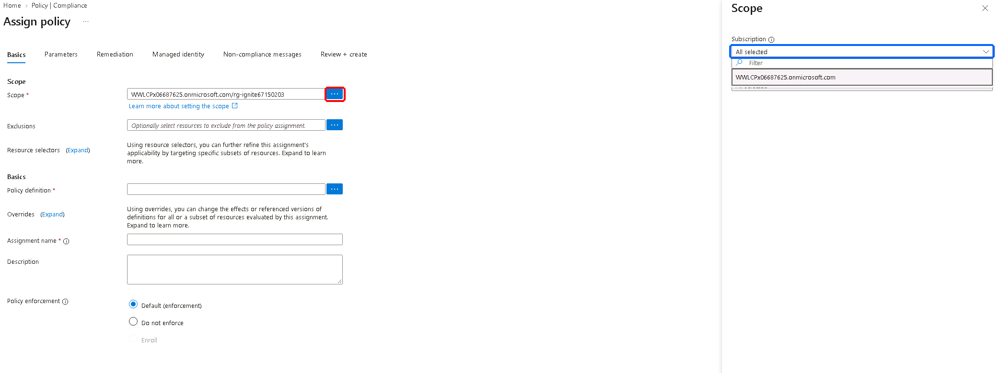
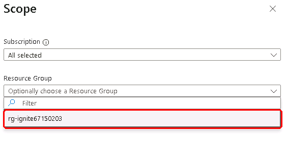
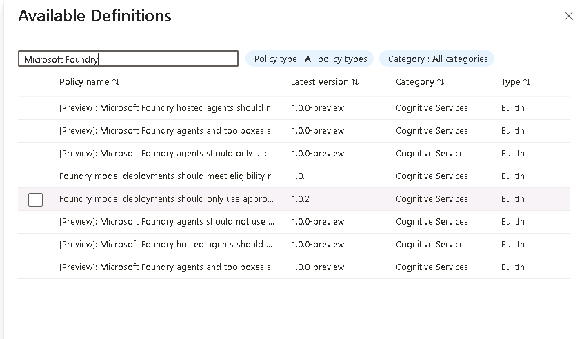
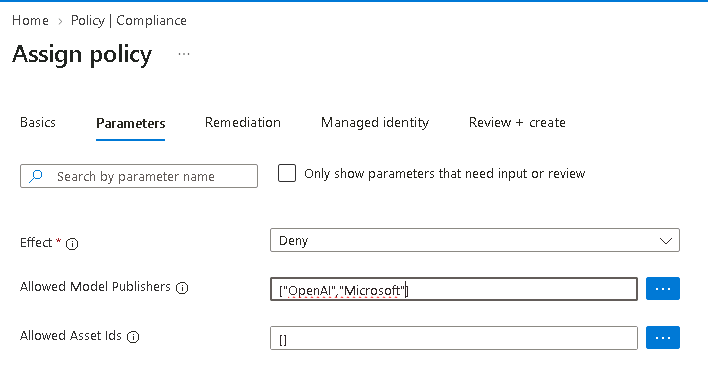
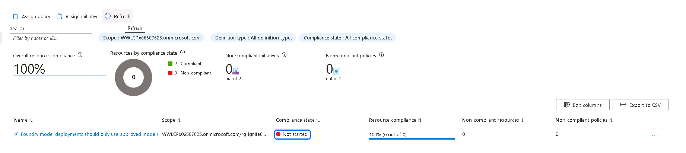

# Sign in and set up governance (10 minutes)

You only need a browser for this lab. You'll use one lab account to sign in to the Microsoft 365 admin center, Microsoft Foundry and the Azure portal.

| Credential | Value |
|---|---|
| **Username** | +++@lab.CloudCredential(AITour27M365E7).Username+++ |
| **Password** | +++@lab.CloudCredential(AITour27M365E7).Password+++ |

### Sign in

1. Open a new browser tab and go to +++https://admin.microsoft.com+++.
1. Sign in with the **Username** and **Password** above.
1. Open another browser tab and go to +++https://ai.azure.com+++.
1. Sign in with the same **Username** and **Password**.

- [ ] I'm signed in to the Microsoft 365 admin center and to Microsoft Foundry.

> Only use the lab account shown above. Don't sign in with your own work or personal account.

> Your Microsoft 365 lab account has the **AI Administrator** role, which is required to see Agent 365. In your own organization, a Global Administrator assigns this role; ongoing agent governance does not require Global Administrator rights.

### Create the model governance policy

**Business question:** *"How do we make sure teams only deploy models we have approved?"*

You'll create an Azure Policy now and test it in the Microsoft Foundry section. Policies are evaluated asynchronously, so creating one first gives it time to take effect.

1. In the in-private window, open a new tab and go to +++https://portal.azure.com+++. Search for **Policy** and open it.
1. Select **Authoring > Assignments**, then **Assign policy**.
1. Next to **Scope**, select **...**. Leave **Subscription** as is, and under **Resource Group** select the group with the prefix **rg-ignite**. Select **Select**.

   

   

1. Next to **Policy definition**, select **...** and search for +++Microsoft Foundry+++. Select **Foundry model deployments should only use approved models** and choose **Add**.

   

1. Leave **Policy enforcement** as **Default (enforcement)**, then select **Next** to open **Parameters**.
1. Clear **Only show parameters that need input or review**, then set:

   | Parameter | Value |
   |---|---|
   | **Effect** | `Deny` |
   | **Allowed Model Publishers** | +++["OpenAI","Microsoft"]+++ |
   | **Allowed Asset Ids** | +++[]+++ |

   

1. Select **Review + create**, then **Create**.
1. Go to **Policy > Compliance**. The new assignment appears with the compliance state **Not started**.

   

   **Don't wait for the evaluation to finish.** Results are asynchronous. You'll check the policy in Microsoft Foundry in the next sections.

- [ ] The assignment **Foundry model deployments should only use approved models** exists on my **rg-ignite** resource group.

> [!Knowledge]
> The same Azure Policy assignment appears in Microsoft Foundry under **Manage > Compliance**. Platform teams define it once and every model deployment in scope is checked against it.

