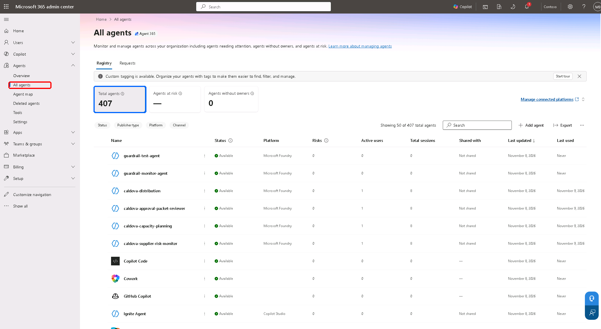

# Agent 365 — Find every agent (20 minutes)

**Business question:** *"What agents do we have, where did they come from, and who owns them?"*

Agent 365 isn't a separate tool to buy and learn from scratch. It's part of the Microsoft 365 admin center that your IT team already uses. First, we are going to build a simple Agent in Copilot Studio and publish it. Then we will see it appear in Agent 365, then we will take action on it. 

### Step 0: Build a simple agent in Copilot Studio 

1. Open another browser tab and go to +++https://copilotstudio.microsoft.com+++.
1. On the lower left side, there is an icon that looks like a globe on top of a sheet of paper, right above the user's profile picture. Select this icon and change the environment to **AlexWDev**.
1. In the center of the page, select the **Agent** card. This opens the Copilot Studio agent builder view.
1. You will see a screen with a **Untitled** title field and **Instructions** on the left side and some agent building tools such as **Models**, **Channels**, **Skills**, **Tools** and **Knowledge** on the right side.
1. In the **Untitled** title field, type +++Caldova - Procurement+++.
1. In the **Instructions** field, type +++You are a procurement agent helping Caldova choose suppliers.+++
1. On the right side, leave the **Model** the way it is and select **Channels**. Choose **Teams + Microsoft 365** as the channel where you will publish the agent.
1. In the upper right corner, select **Publish**.

### Step 1: Open the Microsoft 365 admin center

1. Go to the browser tab with the Microsoft 365 admin center (+++https://admin.microsoft.com+++).
1. If you only see a few items in the left navigation, select **Show all**.

### Step 2: Find Agent 365

1. In the left navigation, select **Agents**.
1. Take a moment to look at the Agent 365 overview page called **Overview**. This page gives you a view into what is going on in your agent estate and calls out anything that needs your immediate attention. It also helps you answer questions from stakeholders across your org.
1. Look at the **Pending requests** card for agents. Are there any current requests?

 

### Step 3: Explore the Agent Registry

**Question:** *"How many agents do we have?"*

1. In the left pane, select **All agents**.
1. Look over the list. Notice that the agents come from different places, such as **Copilot Studio**, **Microsoft Foundry** and other sources.
1. Filter by **Microsoft Foundry** to see the agents that were built in Microsoft Foundry.

- [] I can see agents from more than one source in the Agent Registry.

### Step 4: Explore the Agent Map

**Question:** *"How are our agents connected to people, data and each other?"*

1. In the left pane, select **Agent Map**.
1. Explore the map. Look for which agents connect to which users, data sources or other agents.

> [!Hint]
> A real organization can have thousands of agents. That scale is the reason a governance tool exists.

### Step 5: Find the Tools Registry

**Question:** *"What can our agents connect to and act on?"*

1. Select **Tools** in the left pane.
1. Review the plugins, skills, MCP servers and connectors that agents can use. Each tool gives an agent another way to reach your data or take action.
1. Select the plugin called **Service**, then select **Users** to see who in the org can use it.

### Step 6: Give an agent a new owner

**Question:** *"Who's accountable when an agent goes wrong?"*

1. Go back to **All agents**.
1. Find the Copilot Studio agent **Caldova - Procurement**. Its owner field currently lists AlexW. We want to change this to the new leader of Procurement, Diego Siciliani.
1. Open the agent and select **Assign new owner** in the upper right area.
1. Assign the owner +++Diego Siciliani+++, then select **Save**.

- [] The Copilot Studio agent now has a new owner.

  
### Step 7: Do some automatic agent management 

**Question:** *"What can we do automatically vs manually one-at-a-time?"*

1. In the left pane, select **Settings**.
1. Select **Agent Management Rules**.
1. Select **Reassign ownerless agents created with Agent Builder to manager**.
1. Look through the rule and its conditions. You can automatically reassign ownerless agents.
1. Go back to the main **Agent Management Rules** page and find **Add a rule** at the top. You can create your own automation rules for your org.

- [] You know how to automatically create rules to govern your agents

### Step 8: Find a Foundry agent, then drill down

**Question:** *"This agent was built by our developers. What can they see and control?"*

1. In **All agents**, search for +++caldova-capacity-planning+++.
1. Open it and notice that its source is **Microsoft Foundry**. It appears here automatically because it was built in the same organization.
1. Make a note of what Agent 365 shows you about this agent. Next, you'll open the same agent in Microsoft Foundry and see the developer's view.

> [!Knowledge]
> **What about Microsoft Purview and Microsoft Defender?** To see exactly what each agent did and to investigate threats, security teams use Purview and Defender. Those tools need specialist security roles, so they were covered in the opening demo rather than in this lab.
