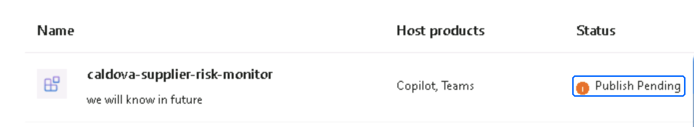
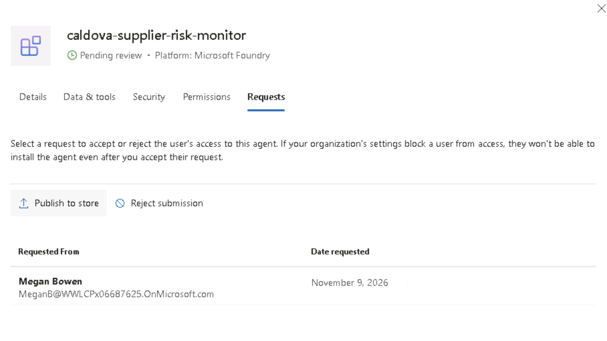
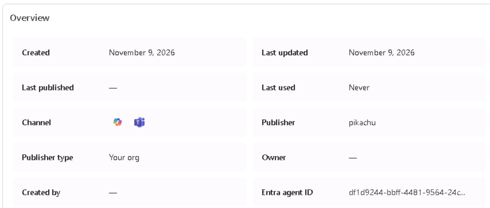
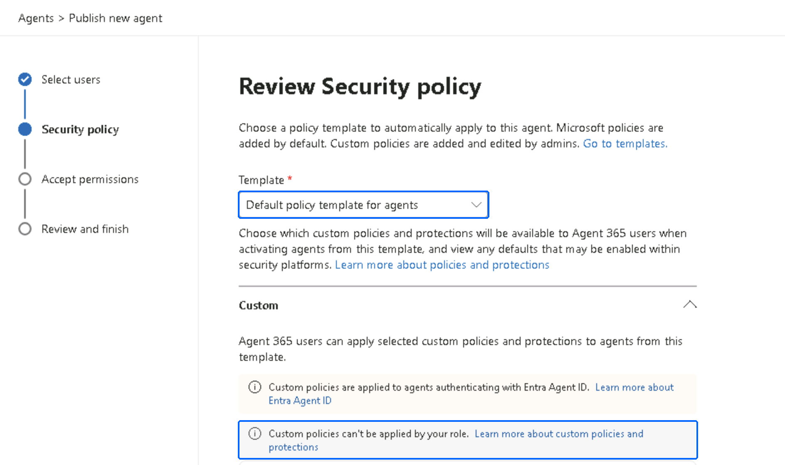
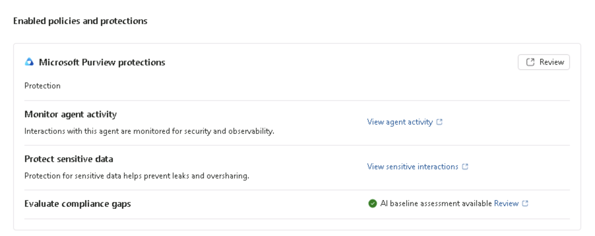

# Better together (15 minutes)

**Business question:** *"A developer published a Foundry agent to Microsoft 365 Copilot. How does IT approve it, apply controls and confirm it works?"*

Developers build and publish in Microsoft Foundry. IT approves, secures and governs the same agent in Agent 365.

### Step 1: Review the publish request

> [!Hint] If you don't see the request, select the **Refresh** icon to refresh the list. It can take a moment for a newly published agent to appear.

1. Go back to the Microsoft 365 admin center tab and select **Agents > All agents**, then open the **Requests** view.
1. Find the request for **caldova-capacity-planning**. The status is **Pending review**.

   

1. Open the agent and review each tab before you decide:
   - **Details:** who published it, the channels (Microsoft 365 Copilot and Teams) and the Entra agent ID.
   - **Data & tools:** what the agent can reach.
   - **Security:** the policies and protections that apply.
   - **Permissions:** the permissions the agent needs.
   - **Requests:** who asked for access and when.

   

   

### Step 2: Approve with controls

1. Select **Publish to store** to start the **Publish new agent** steps.
1. In **Select users**, choose who can use the agent. For this lab, select **All users**. In your own organization, start with a small pilot group.
1. In **Security policy**, keep **Default policy template for agents**. Review the custom policies and protections that apply to the agent.

   

1. In **Accept permissions**, review the permissions the agent requests and accept them.
1. In **Review and finish**, check your choices and select **Finish**.
1. Open the agent again and review **Security**. Confirm that **Microsoft Purview protections** are listed: monitor agent activity, protect sensitive data and evaluate compliance gaps.

   

1. Assign an owner to the agent so that someone is accountable for it.

> [!Knowledge] Custom policies can't be applied by every admin role. If an option is unavailable, the template still applies the Microsoft default policies.

- [ ] I approved **caldova-capacity-planning**, chose who can use it and reviewed the security protections that came with it.

### Step 3: Test the agent in Microsoft 365 Copilot

> [!Hint] It can take a few minutes after approval for the agent to appear. Refresh the page if you don't see it.

1. Open a new browser tab and go to +++https://m365.cloud.microsoft/chat+++. Sign in with the same **Username** and **Temporary Access Password** from the sign-in page.
1. Open the **Agents** store and find **caldova-capacity-planning** under **Built by your org**. Select it.

1. Send this request:

   ```text
   Summarize for the council: which capacity claims are supported, what is missing, and who must approve a supplier change?
   ```

1. Check that the response separates supported claims from gaps and says that a supplier change must be approved by Procurement and Quality. The agent is read-only; it must not claim to book capacity or authorize anything.
1. Go back to the Microsoft 365 admin center, open **caldova-capacity-planning** and check **Last used**.
1. Return to Microsoft Foundry, open the agent's **Traces** and find the request you just sent.

- [ ] I used the published agent in Microsoft 365 Copilot and found the same activity in Agent 365 and Foundry.

> [!Knowledge]
> **Developer context + enterprise IT context = end-to-end agent governance.**
> - **Foundry on its own** gives developers observability, guardrails, cost controls and policies for the agents they build.
> - **Agent 365 on its own** gives IT one registry, one map and clear ownership for every agent, wherever it was built, including Copilot Studio, Foundry and shadow AI.
> - **Together:** what developers build in Foundry shows up for IT in Agent 365, IT approves and controls how it reaches employees, and IT can drill down to the developer's view when it needs more detail.
